# AI Avatar, MIRADO con capturas — 11/11/2026

La prueba del 10/11 (`ai-avatar-10-11.md`) se hizo leyendo el texto de la página y el código, y no marcó lo que Martín vio
al abrirla: miniaturas grises. Esta vez cada pantalla se miró con una captura, en `hola-mako.com/ai-avatar?ws=3` (Cliente
de Prueba, como super admin), a 1440 de ancho y a 375 (teléfono), y se criticó al lado de HeyGen y Higgsfield. Las
capturas están en `ai-avatar-11-11/`. **Ojo:** producción todavía no tiene los 9 arreglos del 10/11 (salen con el despliegue
de las 08:05 UTC del 11/11): lo que se ve acá es la versión anterior.

**Resultado:** 12 pantallas y estados mirados (11 de MaKo y la subida a Flow, probada con una foto real). 11 fallas. 9 arregladas, con su test
(probado rompiéndolo): la subida a Flow, las imágenes de los 31 presets (y con ellas el abanico vacío y el texto ilegible sobre
el degradado), las plantillas de venta, «Personaje», el botón «Generar» que no decía por qué, y en el teléfono la barra que
tapaba los presets y la ranura «Preset» vacía. Quedan 2, de pantallas compartidas por todas las tabs. Una decisión para Martín.

## Lo primero que se veía: 31 de los 33 presets sin imagen — ARREGLADO (11/11, 07:00 UTC)

- **Qué se ve:** en la grilla de presets, sólo «Charla en el auto» y «Presentador en la oficina» tienen foto. Los otros 31
  eran un degradado celeste o rosado con el nombre arriba y el lugar escrito abajo, en gris claro sobre celeste, que casi
  no se lee ([02](ai-avatar-11-11/02-grilla-presets-grises.jpg)). En «Nuevo avatar» es peor: un marco gris con un teléfono
  blanco vacío ([09](ai-avatar-11-11/09-nuevo-avatar-presets-grises.jpg)). En el teléfono, lo mismo
  ([11](ai-avatar-11-11/11-celular-grilla.jpg)).
- **Al lado de Higgsfield:** cada preset tiene su foto, y su video al pasar el mouse. Es lo que te dice qué vas a obtener;
  sin eso, un preset es una palabra.
- **Arreglado:** los 31 tienen su imagen, hecha en Google Flow (0 créditos: Flow lo dice antes de generar) con la cara de
  Martín —su foto `1-headshot-saco.jpg`, la misma persona de los dos ejemplos que ya había— y el MISMO prompt que usa el
  producto para ese preset. En el gimnasio y en la playa se agregó la ropa como lo escribiría una persona en la barra («Con
  ropa deportiva», «Con camisa de lino clara, sin saco»): el prompt copia la ropa de la foto, y un saco en la playa no
  servía. Cada imagen se miró antes de subirla. Van en `public/formatos/presets/` (`formatos/` es de las carpetas que el proxy deja pasar sin sesión), a 540 de ancho (unos 70 KB cada una).
  Con ellas se llenan además el abanico de arriba, «Nuevo avatar» y las tarjetas de las 10 plantillas de venta.
- **Falta mirarlo en producción** después del despliegue.

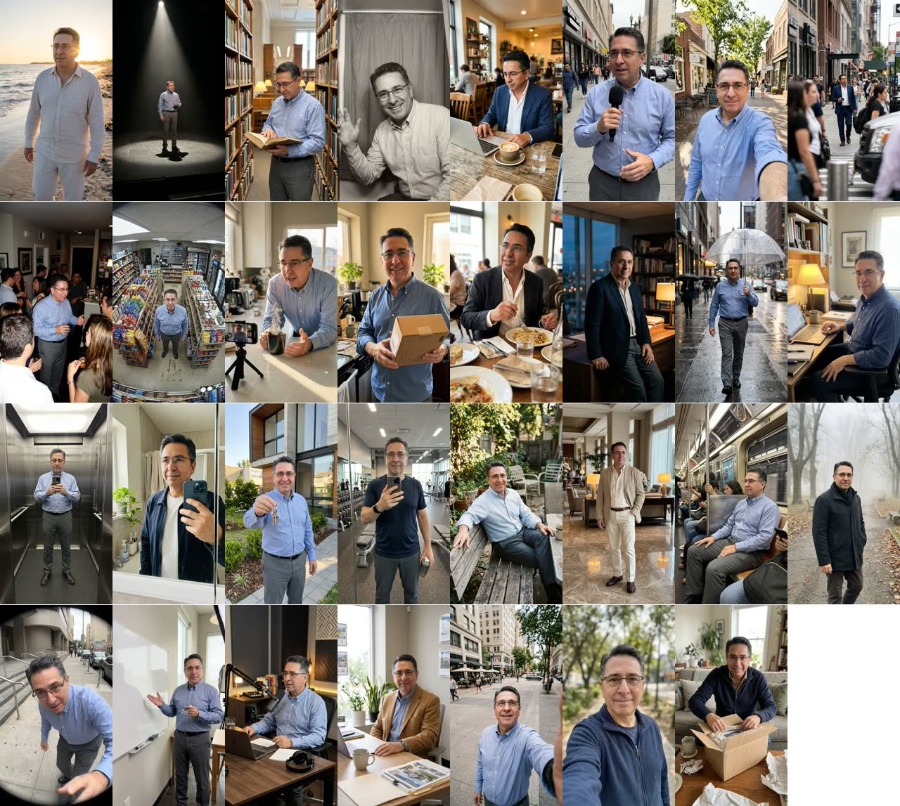

Antes:

## La foto no llegaba a Flow — ARREGLADO (extensión 0.80.0) y probado con una foto real

Ninguna foto de AI Avatar llegaba a Flow desde el 8/11, y sin foto no sale ningún avatar.

- **Lo que parecía:** «Flow no mostró la opción de subir». Esa causa (el ícono pegado al texto del menú) ya estaba arreglada
  desde el 8/11 y tapaba otra: el único intento posterior dijo «Flow no terminó de procesar la foto», y la foto no estaba en
  «Uploads» del proyecto de Flow.
- **La causa (medida hoy en Flow, con la cuenta de Martín):** Flow cambió. Su botón «Upload» abre el selector de archivos
  sólo con un clic de mouse de verdad, y la extensión no puede darlo. Con el clic de la extensión, el menú se cierra y no
  pasa nada.
- **El arreglo:** la extensión ahora SUELTA la foto sobre el proyecto, como quien la arrastra. Se probó soltando un archivo de
  texto: Flow lo rechazó por el tipo («Unsupported file type…»), o sea que lo recibió, y no se subió nada a la cuenta. Si
  Flow vuelve a no aceptarla, la falla ahora dice lo que avisó Flow, en vez de «no terminó de procesar».
- **Probado con una foto real (11/11, 05:10 UTC):** la foto base, soltada sobre el proyecto de Flow de Martín con el MISMO código
  de la extensión, apareció con su nombre a los 8 segundos y con su número de Flow a los 14, que es lo que la extensión espera
  para dar la foto por subida.

  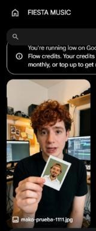
- **Falta:** la cadena entera desde MaKo («Personaje» → la extensión → Flow → el avatar). Pide la extensión 0.80.0 instalada en
  el Chrome de Flow y conectada al negocio de prueba; hoy está conectada al negocio de Martín, y conectarla al de prueba lo
  desconecta de ese.

## Las plantillas de venta eran cajas de texto — ARREGLADO

- **Qué se veía:** las 10 tarjetas eran una hoja de texto chico que repetía el nombre de la plantilla («Confesión en el
  auto» arriba, adentro, y otra vez abajo), sin una sola imagen.
- **Ahora:** con imagen de su escena (3 de las 10 hoy, las 10 cuando estén las de los presets), la tarjeta muestra la foto y,
  con el mouse encima, el video. Sin imagen, la hoja muestra el gancho real del ejemplo: el texto en pantalla («3 "lo voy a
  pensar" esta semana») y la primera frase que dice el avatar, entre comillas. El nombre queda una sola vez, abajo.
- **De paso:** los presets de «Nuevo avatar» ahora pasan su video a la tarjeta, que ya lo sabía mostrar al pasar el mouse.

## La puerta desde Video, «Tu personaje con IA», era un marco vacío — ARREGLADO

Desde el 11/11 AI Avatar se abre desde «Nuevo video» (la tarjeta «Tu personaje con IA»). La tarjeta no tenía imagen: era un
marco con «Desde tu foto», la misma miniatura gris. Ahora muestra el preset «Selfie de iPhone» con la cara de Martín. Vive en
`app/video-editor/plantillas-crear.ts` (ninguna rama de Video la tocaba).

## «Personaje» era un «+» solo — ARREGLADO

- **Qué se veía:** «Tu cara», un cuadrado gris con un «+», y abajo «Diseñar un personaje · No disponible todavía». Nada dice
  qué foto sirve, que es lo que decide si el avatar se te parece. HeyGen lo dice en el mismo paso.
- **Ahora:** mientras no hay ninguna foto, debajo del «+» dice «Una foto tuya de frente, sola y con buena luz.», en la
  computadora y en el teléfono.

## Las mejoras de diseño (tres arregladas el 11/11)

| Qué se ve | Captura | Mejora | Dónde vive |
|---|---|---|---|
| La lista de avatares vacía es una columna entera con una línea: «Todavía no hay ninguno.» | [07](ai-avatar-11-11/07-lista-vacia.jpg) | Un estado vacío que invite: «Tu primer avatar» con el ejemplo y el botón. | La pantalla compartida de Create (`app/_crear`): cambia todas las tabs. |
| A la izquierda, el chat del negocio muestra un mensaje viejo del Dashboard y «No te pude contestar esto» en rojo. | [01](ai-avatar-11-11/01-inicio-escritorio.jpg) | El chat de una tab de Create debería abrir en lo de esa tab, y un error viejo no debería quedar a la vista. (El negocio de prueba no tiene IA conectada.) | El chat compartido (`app/_chat`). |
| ~~En el teléfono, la barra de abajo ocupa el 40 % de la pantalla: se ve una fila y media de presets.~~ **ARREGLADO:** las pastillas y «Generar» van en una fila, como Higgsfield (medido en producción antes de subirlo: 192 → 132 px). | [10](ai-avatar-11-11/10-celular-inicio.jpg) | — | `app/m/ai-avatar/EstudioM.tsx` |
| ~~En el teléfono, la ranura «Preset» es un cuadro blanco vacío y no dice que se elige arriba.~~ **ARREGLADO:** vacía dice «Elige arriba». | [10](ai-avatar-11-11/10-celular-inicio.jpg) | — | `app/m/ai-avatar/EstudioM.tsx` |
| ~~«Generar · Gratis» está gris y el botón no dice por qué.~~ **ARREGLADO:** apagado dice lo que falta («Falta el preset», «Faltan 4 pasos», «Falta tu foto»), y la línea entera con el mouse encima. | [01](ai-avatar-11-11/01-inicio-escritorio.jpg) | — | `app/ai-avatar/Estudio.tsx`, `lib/ai-avatar/estudio.ts` |
| «Antes de generar»: cuatro pasos técnicos (extensión, conectar, Flow, foto) antes de ver un resultado. En HeyGen subes una foto y generas. | [06](ai-avatar-11-11/06-antes-de-generar.jpg) | Es el precio de generar con la cuenta de Flow de cada persona; se puede achicar mostrando el ejemplo del preset mientras tanto. | `lib/ai-avatar/requisitos.ts` |

## Para Martín

- **Tres cosas dicen «no disponible todavía» en la pantalla:** las baldosas «Motion» y «Crear influencer» al final de la
  grilla ([03](ai-avatar-11-11/03-final-baldosas-muertas.jpg)) y «Diseñar un personaje»
  ([05](ai-avatar-11-11/05-personaje-vacio.jpg)). Están porque se copió Higgsfield tal cual (29/10). ¿Se dejan, o se sacan
  hasta que existan?

## Lo que no se pudo mirar

- **MaKo en Chrome con la sesión de Martín.** A las 05:05 UTC los dos Chrome conectados seguían con la sesión de MaKo de
  Leandro (ws 10, un cliente real): no se abrió MaKo ahí. Las capturas de MaKo son del navegador de la app, con la sesión de
  Martín y el negocio de prueba.

- **Generar un avatar y un video.** Sin la foto en Flow no sale nada; el arreglo está en la extensión 0.80.0 y falta
  instalarla y probarla en vivo. El video sigue pidiendo el OK de Martín a la imagen, y el techo de 15 créditos por toma
  sigue debajo de los 24 medidos el 9/11 (`ai-avatar-10-11.md`).
- **Un proyecto con su avatar y sus videos, y «Descargar»:** el negocio de prueba no tiene ninguno.
- **El modo oscuro de MaKo** no sale del modo oscuro del sistema: emularlo no cambia la pantalla. Se miró el 10/11 con el
  selector de la app.

## En producción, después del despliegue (11/11, 14:40–15:00 UTC)

El despliegue salió a las 11:05 UTC con main en `ada98995d`. Probado en el navegador de la app con la sesión de Martín, dentro
del negocio de prueba (comprobado con `/api/auth/me`: ws 3, «Cliente de Prueba», como administrador).

**1. Las imágenes cargan SIN sesión: 31 de 31** responden `200 image/jpeg` (por `curl`, sin cookies, y en una pestaña sin sesión
de MaKo). La dirección vieja, `/ai-avatar/presets/…`, manda al login (307): por eso viven en `/formatos/presets/`.

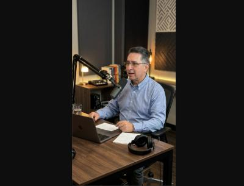

**2. Las puertas.**
- **Computadora, Video → «Crear desde cero» → «Tu personaje con IA»:** la tarjeta ya muestra la foto (antes, marco vacío) y abre
  AI Avatar en el negocio de prueba. ✔
  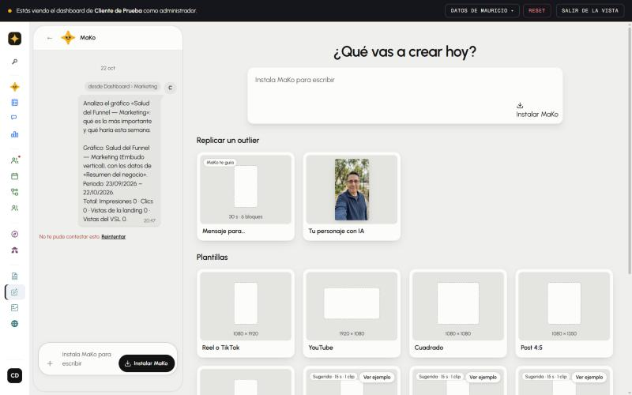
  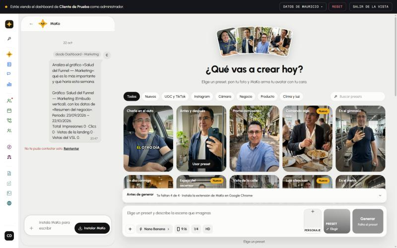
- **`/ai-avatar` y `/m/ai-avatar`:** abren; en el teléfono, 33 baldosas y las 33 con foto. ✔
- **Teléfono, Video → «Nuevo video»: la tarjeta SEGUÍA siendo un marco vacío.** La hoja del teléfono dibujaba sus tarjetas a mano
  y nunca miraba la imagen. **Arreglado** (`app/m/video-editor/InicioVideoM.tsx`, con su test; sale en el próximo despliegue). Así
  va a quedar, simulado en producción:
  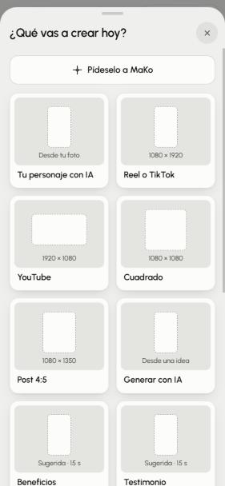
  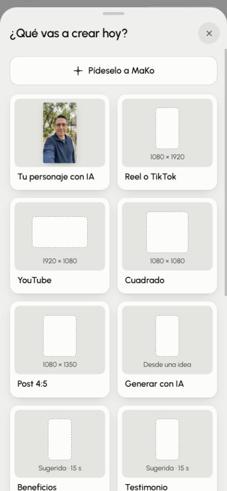

**3. Los presets en pantalla.** A 1440 y a 375, los 33 con su foto; el abanico de arriba con 4 fotos; «Nuevo avatar» con las 10
plantillas de venta y los presets con foto; en el teléfono la barra en una fila y «Elige arriba». ✔

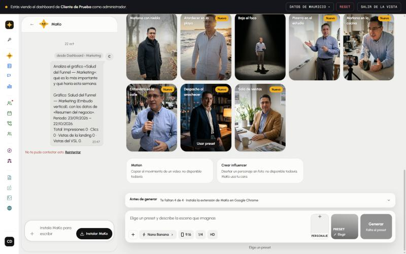
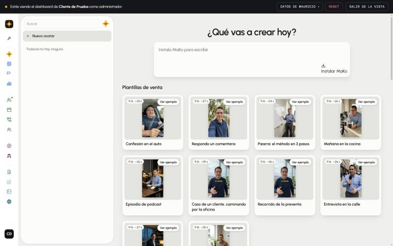
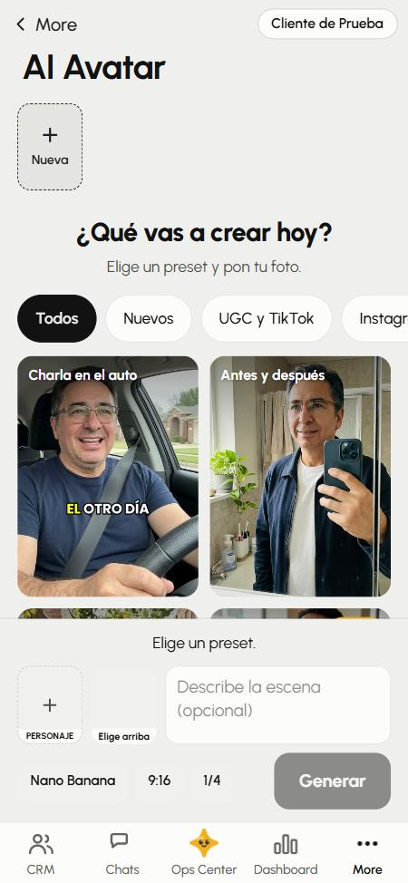

**4. Crear un avatar en el negocio de prueba**, hasta donde se puede sin la extensión:
- Elegir «Antes y después»: queda marcado, la ranura muestra su foto y «Cambiar», y «Generar» dice **«Faltan 4 pasos»**. ✔
- «Personaje»: dice «Una foto tuya de frente, sola y con buena luz.». Se subió una foto real de Martín: «Listo: tu foto quedó en
  Personaje.», la miniatura en la ranura, el paso 4 tachado, «Te faltan 3 de 4» y «Generar» dice **«Faltan 3 pasos»**. ✔
- Los 3 que faltan son la extensión de Chrome, conectarla a ESTE negocio y abrir Flow: el navegador de la app no tiene la
  extensión, y la del Chrome de Martín está conectada a su negocio, no al de prueba. **Generar no se pudo probar desde acá.**
- En el teléfono, el mismo momento: preset marcado, la foto en «Personaje», y «Antes de generar: En tu computadora, instala la
  extensión de MaKo en Google Chrome.». ✔

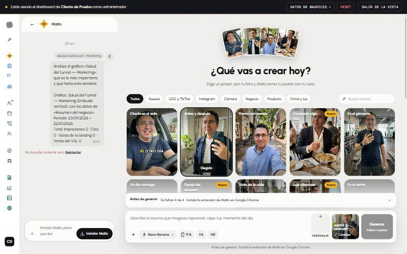
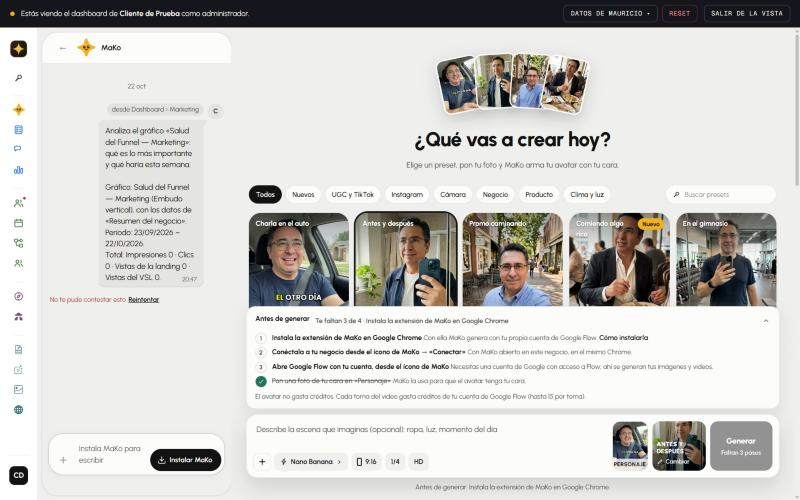
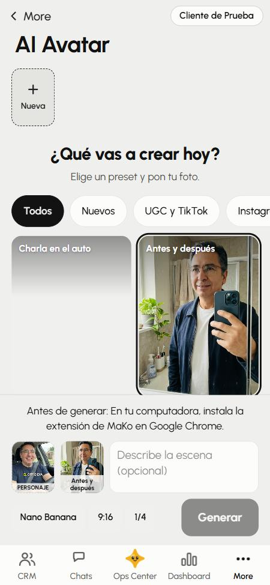

**Crítica que queda, al lado de HeyGen e Higgsfield:**
- **Las tarjetas de «Nuevo avatar» dibujan la foto vertical chica dentro de una caja gris 4:3**: mucho gris alrededor. HeyGen
  llena la tarjeta. Es la tarjeta compartida de Create (`app/_crear/TarjetaPlantilla.tsx`, `cajaDeMiniatura`): cambia todas las tabs.
- Dos plantillas de venta («Caso de un cliente» y «Recorrido de la preventa») muestran la misma foto: usan el mismo preset.
- **En Video siguen grises** las otras tarjetas de «Nuevo video» («Mensaje para…», «Reel o TikTok», «YouTube»…) y, al cargar, las
  miniaturas de los outliers; la portada de Video en el teléfono se ve lavada, como semitransparente. Es de Video, no de AI Avatar.
- El chat de la izquierda con un mensaje viejo del Dashboard y «No te pude contestar esto» en rojo; «More» en inglés en el
  teléfono. Son del marco compartido.
- Para crear el primer avatar hacen falta 3 pasos técnicos (extensión, conectar, Flow) antes de ver nada; en HeyGen, una foto.
