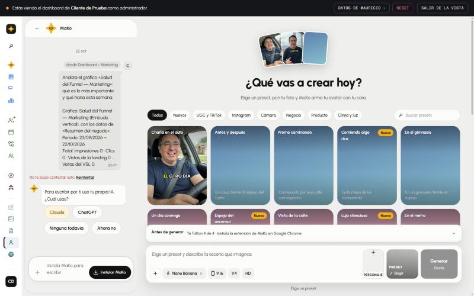
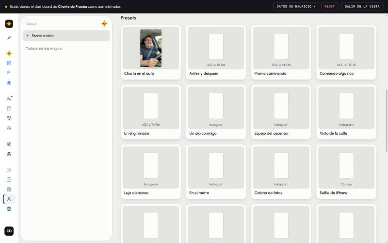
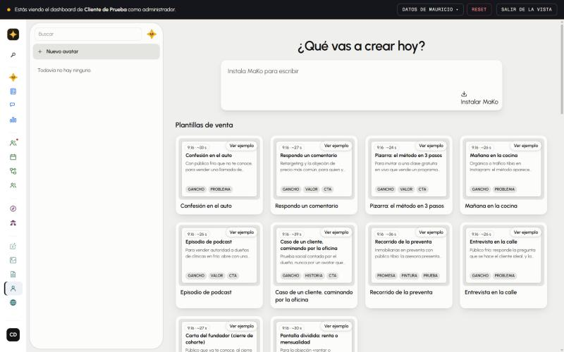
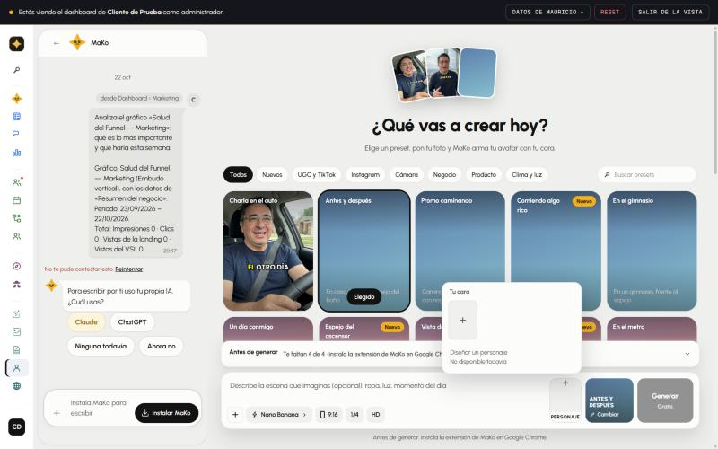

# AI Avatar, MIRADO con capturas — 11/11/2026

La prueba del 10/11 (`ai-avatar-10-11.md`) se hizo leyendo el texto de la página y el código, y no marcó lo que Martín vio
al abrirla: miniaturas grises. Esta vez cada pantalla se miró con una captura, en `hola-mako.com/ai-avatar?ws=3` (Cliente
de Prueba, como super admin), a 1440 de ancho y a 375 (teléfono), y se criticó al lado de HeyGen y Higgsfield. Las
capturas están en `ai-avatar-11-11/`. **Ojo:** producción todavía no tiene los 9 arreglos del 10/11 (salen con el despliegue
de las 08:05 UTC del 11/11): lo que se ve acá es la versión anterior.

**Resultado:** 12 pantallas y estados mirados (11 de MaKo y el «Subir» de Flow). 11 fallas. 3 arregladas, con su test
(probado rompiéndolo), y 2 más que se arreglan solas cuando estén las imágenes. Una decisión para Martín.

## Lo primero que se ve: 34 de los 36 presets no tienen imagen — SIN ARREGLAR

- **Qué se ve:** en la grilla de presets, sólo «Charla en el auto» y «Presentador en la oficina» tienen foto. Los otros 34
  son un degradado celeste o rosado con el nombre arriba y el lugar escrito abajo, en gris claro sobre celeste, que casi
  no se lee ([02](ai-avatar-11-11/02-grilla-presets-grises.jpg)). En «Nuevo avatar» es peor: un marco gris con un teléfono
  blanco vacío ([09](ai-avatar-11-11/09-nuevo-avatar-presets-grises.jpg)). En el teléfono, lo mismo
  ([11](ai-avatar-11-11/11-celular-grilla.jpg)).
- **Al lado de Higgsfield:** cada preset tiene su foto, y su video al pasar el mouse. Es lo que te dice qué vas a obtener;
  sin eso, un preset es una palabra.
- **Mejora:** una imagen por preset, hecha con la base del personaje de Martín (como las dos que ya hay). Se generan en Flow
  (las imágenes no gastan créditos), una por preset, y se mira cada una antes de subirla. Con ellas se llenan además el
  abanico de arriba (hoy su tercera carta es un rectángulo celeste vacío) y las tarjetas de las plantillas de venta, que
  desde hoy toman la imagen de su preset.
- **Por qué no está hecho:** generar pide Chrome con Flow, y el Cerebro tiene el turno de ese navegador.

## La foto no llegaba a Flow — ARREGLADO (extensión 0.80.0), falta probarlo en vivo

Ninguna foto de AI Avatar llegaba a Flow desde el 8/11, y sin foto no sale ningún avatar.

- **Lo que parecía:** «Flow no mostró la opción de subir». Esa causa (el ícono pegado al texto del menú) ya estaba arreglada
  desde el 8/11 y tapaba otra: el único intento posterior dijo «Flow no terminó de procesar la foto», y la foto no estaba en
  «Uploads» del proyecto de Flow.
- **La causa (medida hoy en Flow, con la cuenta de Martín):** Flow cambió. Su botón «Upload» abre el selector de archivos
  sólo con un clic de mouse de verdad, y la extensión no puede darlo. Con el clic de la extensión, el menú se cierra y no
  pasa nada.
- **El arreglo:** la extensión ahora SUELTA la foto sobre el proyecto, como quien la arrastra. Se probó soltando un archivo de
  texto: Flow lo rechazó por el tipo («Unsupported file type…»), o sea que lo recibió, y no se subió nada a la cuenta. Si
  Flow vuelve a no aceptarla, la falla ahora dice lo que avisó Flow, en vez de «no terminó de procesar».
- **Falta:** probarlo con una foto real. Pide la extensión 0.80.0 instalada en el Chrome que tiene Flow, y un avatar en el
  negocio de prueba.

## Las plantillas de venta eran cajas de texto — ARREGLADO

- **Qué se veía:** las 10 tarjetas eran una hoja de texto chico que repetía el nombre de la plantilla («Confesión en el
  auto» arriba, adentro, y otra vez abajo), sin una sola imagen.
- **Ahora:** con imagen de su escena (3 de las 10 hoy, las 10 cuando estén las de los presets), la tarjeta muestra la foto y,
  con el mouse encima, el video. Sin imagen, la hoja muestra el gancho real del ejemplo: el texto en pantalla («3 "lo voy a
  pensar" esta semana») y la primera frase que dice el avatar, entre comillas. El nombre queda una sola vez, abajo.
- **De paso:** los presets de «Nuevo avatar» ahora pasan su video a la tarjeta, que ya lo sabía mostrar al pasar el mouse.

## «Personaje» era un «+» solo — ARREGLADO

- **Qué se veía:** «Tu cara», un cuadrado gris con un «+», y abajo «Diseñar un personaje · No disponible todavía». Nada dice
  qué foto sirve, que es lo que decide si el avatar se te parece. HeyGen lo dice en el mismo paso.
- **Ahora:** mientras no hay ninguna foto, debajo del «+» dice «Una foto tuya de frente, sola y con buena luz.», en la
  computadora y en el teléfono.

## Sin arreglar (mejoras de diseño)

| Qué se ve | Captura | Mejora | Dónde vive |
|---|---|---|---|
| La lista de avatares vacía es una columna entera con una línea: «Todavía no hay ninguno.» | [07](ai-avatar-11-11/07-lista-vacia.jpg) | Un estado vacío que invite: «Tu primer avatar» con el ejemplo y el botón. | La pantalla compartida de Create (`app/_crear`): cambia todas las tabs. |
| A la izquierda, el chat del negocio muestra un mensaje viejo del Dashboard y «No te pude contestar esto» en rojo. | [01](ai-avatar-11-11/01-inicio-escritorio.jpg) | El chat de una tab de Create debería abrir en lo de esa tab, y un error viejo no debería quedar a la vista. (El negocio de prueba no tiene IA conectada.) | El chat compartido (`app/_chat`). |
| En el teléfono, la barra de abajo ocupa el 40 % de la pantalla: se ve una fila y media de presets. | [10](ai-avatar-11-11/10-celular-inicio.jpg) | Como Higgsfield: una barra de una línea que se abre al tocarla. | `app/m/ai-avatar/EstudioM.tsx` |
| En el teléfono, la ranura «Preset» es un cuadro blanco vacío y no dice que se elige arriba. | [10](ai-avatar-11-11/10-celular-inicio.jpg) | Que diga «Elige arriba» o muestre una flecha. | `app/m/ai-avatar/EstudioM.tsx` |
| «Generar · Gratis» está gris y el botón no dice por qué; el motivo va en una línea chica debajo. | [01](ai-avatar-11-11/01-inicio-escritorio.jpg) | Que el botón diga lo que falta («Falta tu foto»). | `app/ai-avatar/Estudio.tsx` |
| «Antes de generar»: cuatro pasos técnicos (extensión, conectar, Flow, foto) antes de ver un resultado. En HeyGen subes una foto y generas. | [06](ai-avatar-11-11/06-antes-de-generar.jpg) | Es el precio de generar con la cuenta de Flow de cada persona; se puede achicar mostrando el ejemplo del preset mientras tanto. | `lib/ai-avatar/requisitos.ts` |

## Para Martín

- **Tres cosas dicen «no disponible todavía» en la pantalla:** las baldosas «Motion» y «Crear influencer» al final de la
  grilla ([03](ai-avatar-11-11/03-final-baldosas-muertas.jpg)) y «Diseñar un personaje»
  ([05](ai-avatar-11-11/05-personaje-vacio.jpg)). Están porque se copió Higgsfield tal cual (29/10). ¿Se dejan, o se sacan
  hasta que existan?

## Lo que no se pudo mirar

- **Generar un avatar y un video.** Sin la foto en Flow no sale nada; el arreglo está en la extensión 0.80.0 y falta
  instalarla y probarla en vivo. El video sigue pidiendo el OK de Martín a la imagen, y el techo de 15 créditos por toma
  sigue debajo de los 24 medidos el 9/11 (`ai-avatar-10-11.md`).
- **Un proyecto con su avatar y sus videos, y «Descargar»:** el negocio de prueba no tiene ninguno.
- **El modo oscuro de MaKo** no sale del modo oscuro del sistema: emularlo no cambia la pantalla. Se miró el 10/11 con el
  selector de la app.
